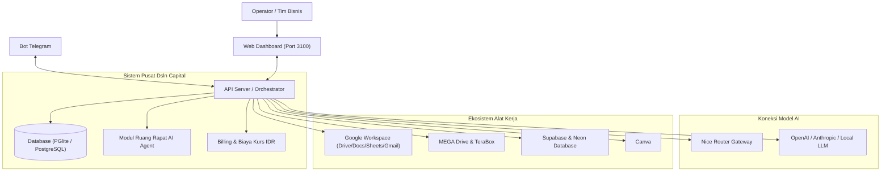

# Dsln Capital — AI Agent Control Plane

<p align="center">
  <strong>Platform Orkestrasi Tim AI Agent Otonom untuk Pengelolaan Bisnis Modern</strong>
</p>

<p align="center">
  <a href="https://github.com/Deni-SLN/dsln-capital-fork-paperclip"></a>
  <a href="https://github.com/Deni-SLN/Nice-Router"></a>
  <a href="https://github.com/Deni-SLN/dsln-capital-fork-paperclip/blob/main/LICENSE"></a>
  
  
</p>

---

## 📌 Tentang Dsln Capital AI Control Plane

**Dsln Capital AI Control Plane** adalah platform kontrol dan orkestrasi tim AI Agent otonom yang dirancang khusus untuk mengelola operasional bisnis, proyek, dan koordinasi kerja cerdas dari satu pusat komando.

Dibangun dengan arsitektur tangguh berbasis Node.js, Express, React, dan Tailwind CSS, sistem ini telah ditingkatkan dengan fitur-fitur unggulan seperti **Custom AI Router (Nice Router)**, **Ruang Rapat Diskusi Antar-Agent**, **Integrasi Telegram**, **Pelaporan Biaya dalam Rupiah (IDR)**, dan dukungan berbagai integrasi cloud storage dan database modern.

---

## 🌟 Fitur Unggulan

### 1. 🤖 Custom AI Provider — Nice Router
* Terintegrasi langsung dengan custom router [Nice-Router](https://github.com/Deni-SLN/Nice-Router.git).
* Memungkinkan penggunaan model AI lokal maupun gateway kustom (OpenAI, Anthropic, Claude, Codex, Gemini, Ollama, DeepSeek, vLLM, LiteLLM) dengan bypass SSRF untuk endpoint jaringan internal.

### 2. 🏛️ Ruang Rapat AI Agent (Autonomous Multi-Agent Meeting)
* **Mode Diskusi Mandiri**: Memberikan tugas atau topik bahasan, lalu AI Agent dari berbagai bidang keahlian (Marketing, Engineer, Finance, Content, Researcher) akan berdiskusi dan saling menanggapi.
* **Pengambilan Keputusan & Kesimpulan**: AI dengan tingkatan tertinggi (CEO / Lead Agent) merangkum seluruh poin penting diskusi dan menghasilkan *Action Plan* terstruktur yang siap dieksekusi.

### 3. 📱 Integrasi Telegram Bot
* Notifikasi langsung ke grup atau chat Telegram pribadi mengenai status pengerjaan tugas, laporan rapat, dan peringatan sistem.
* Kontrol persetujuan manusia (*human-in-the-loop approval*) langsung melalui Telegram.

### 4. 🇮🇩 Lokalisasi & Pelaporan Biaya Rupiah (IDR)
* Antarmuka pengguna telah disesuaikan ke dalam **Bahasa Indonesia** untuk navigasi yang intuitif.
* Perhitungan biaya token dan model AI otomatis dikonversikan ke dalam format mata uang **Rupiah (IDR)** dengan referensi kurs real-time harian.

### 5. ☁️ Ekosistem Konektor Cloud & Alat Kerja Terintegrasi
Pemberian izin dan hak akses alat kerja dapat diatur secara spesifik per-agen:
* **Desain & Kreatif**: Canva
* **Produktivitas & Dokumen**: Google Workspace (Google Drive, Gmail, Google Sheets, Google Docs)
* **Penyimpanan Cloud Kapasitas Besar**: MEGA Drive (`https://mega.nz`), TeraBox (1 TB Cloud Storage via Alist/MCP)
* **Database Modern**: Supabase & Neon Serverless PostgreSQL

---

## 🏗️ Arsitektur Sistem



---

## 🚀 Panduan Memulai Cepat (Quickstart)

### Prasyarat
* [Node.js](https://nodejs.org/) versi 20.x atau lebih baru
* [pnpm](https://pnpm.io/) versi 9.x atau lebih baru (`npm install -g pnpm`)

### 1. Kloning Repositori
```bash
git clone https://github.com/Deni-SLN/dsln-capital-fork-paperclip.git
cd dsln-capital-fork-paperclip
```

### 2. Instal Dependensi
```bash
pnpm install
```

### 3. Konfigurasi Lingkungan (.env)
Salin berkas contoh konfigurasi:
```bash
cp .env.example .env
```
Sesuaikan variabel lingkungan seperti:
* Port server (default: `3100`)
* Token Telegram Bot (opsional)
* Konfigurasi database atau custom provider Nice Router

### 4. Menjalankan Server Pengembangan
```bash
pnpm dev
```

Buka peramban (browser) dan akses:
* **Web UI & Dashboard**: `http://localhost:3100`
* **Status Kesehatan API**: `http://localhost:3100/api/health`

---

## 📁 Struktur Direktori

```text
├── cli/                 # Utilitas Command Line Interface (CLI)
├── doc/                 # Dokumentasi spesifikasi dan panduan teknis
├── packages/
│   ├── db/              # Skema database Drizzle & migrasi
│   ├── shared/          # Tipe data bersama, konstanta, dan validator
│   ├── adapters/        # Adapter agen (Nice Router, Claude, Codex, dll.)
│   └── plugins/         # Sistem plugin ekstensi
├── server/              # Backend Express REST API & orkestrasi AI
└── ui/                  # Antarmuka frontend React + Vite + Tailwind CSS
```

---

## 🛡️ Keamanan & Kontrol Izin

1. **Per-Agent Permissions**: Setiap koneksi alat (Google Drive, Canva, Mega, TeraBox, dll.) dapat dibatasi ke agen tertentu melalui tab **Izin / Permissions**.
2. **Persetujuan Manusia ("Ask First")**: Tindakan yang berpotensi mengubah data penting (seperti kirim email atau modifikasi database) mewajibkan konfirmasi manual sebelum dieksekusi.
3. **Audit Log**: Seluruh mutasi data dan jalannya tugas agen tercatat dalam log aktivitas untuk pengawasan penuh.

---

## 📄 Lisensi

Proyek ini dirilis di bawah lisensi [MIT License](LICENSE).
Dikembangkan dan dikustomisasi oleh **Dsln Capital / Deni-SLN**.
